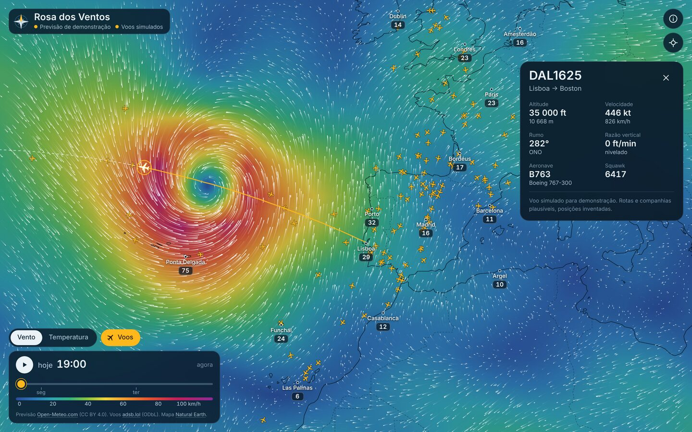
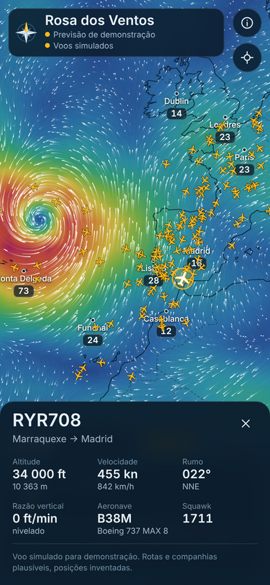
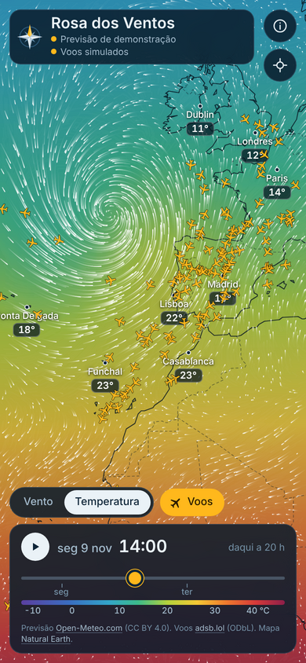

# Rosa dos Ventos: wind and flight radar

An animated wind and temperature map for the next 48 hours, with air traffic on top. Plain JavaScript with no framework, built for phones first, and installable as an app.



<p>
  
  
</p>

**Demo:** https://quintopontocardeal.org/projetos/rosa-dos-ventos/

> Personal project with public data. When a data source cannot be reached, the forecast and the flights are simulated, and the page says so at the top.

## The problem

Wind maps on social media look great, but they are videos. You cannot move the map, pick an hour or tap a plane, and the weather and the traffic live in two different apps.

## The solution

A web app that draws the wind as moving particles over a color field, with an hourly forecast for the next 48 hours and live aircraft on top. Tap the map for the values at that point, or a plane for its altitude, speed, heading, type and the path it has flown.

## The result

A storm and the traffic around it, readable at a glance on one screen, with no sign-up and no ads. When a source fails, the map keeps working on demonstration data and labels it, instead of showing an empty screen.

## Tools

HTML, CSS and JavaScript (ES modules), Leaflet for the map, canvas for the particles and aircraft, Open-Meteo for the forecast, adsb.lol for ADS-B positions, a Cloudflare Worker as a small proxy, and Natural Earth for coastlines and borders.

## How it works

**Weather.** Open-Meteo answers point forecasts, not grids, but it accepts many coordinates in one request. The app lays a regular grid over the visible area (at most 300 points, finer as you zoom in), asks for hourly wind speed, wind direction and temperature, and converts speed and direction into u and v components. Values between grid points come from bilinear interpolation in space and linear interpolation in time, which is what makes the playback smooth. Grid requests are spaced at least 35 seconds apart to stay inside the free tier.

**Rendering.** Projection math is expensive, so it runs once per view change. A coarse screen grid (one cell every 5 px) caches the latitude and longitude under each cell and the wind sampled there. The color field is painted into a tiny image and scaled up with smoothing. Particles read their velocity from the screen grid and leave trails by fading the previous frame. Both canvases live inside Leaflet panes, so they move with the map while you drag. With reduced motion turned on in the system settings, the particles are replaced by a still grid of arrows.

**Flights.** Live positions come from the community ADS-B network [adsb.lol](https://adsb.lol). Its API does not send CORS headers, so a browser cannot call it from another site. The Cloudflare Worker in `worker/` forwards the request and adds the headers. Between updates every aircraft is moved by dead reckoning from its ground speed and track, so motion stays fluid with a refresh every 8 seconds.

**Fallbacks.** Without the forecast API the app draws a synthetic Atlantic depression, and without the proxy it simulates traffic between real airports. Both are labeled in the top bar and in the details of each flight.

**Basemap.** Coastlines and borders are Natural Earth 1:50m data from the `world-atlas` TopoJSON, drawn as vectors. There is no tile server to pay for or rate limit.

## Run it locally

ES modules do not load from `file://`, so serve the folder:

```
npx http-server . -p 8080
```

or `python3 -m http.server 8080`, then open http://localhost:8080. Add `?demo` to the address to force demonstration data. Locally, or on any host that lets the page call other domains, the forecast is live from the first visit.

## Live flights

1. Create a free Cloudflare account and a new Worker. Paste the contents of `worker/flights-proxy.js`, or run `npx wrangler deploy` inside `worker/`.
2. Set the Worker variable `ALLOWED_ORIGINS` to the sites that may use it.
3. Put the Worker address in `flightsProxy` in `js/config.js`.

The Worker accepts one route, `/point/{lat}/{lon}/{radius_nm}`, clamps the radius to 250 nautical miles and rejects anything else. If it stops answering, the app falls back to simulated flights after three failed attempts and tells the user.

## Single-file build

`npm install` and then `npm run build:standalone` write `dist/rosa-dos-ventos.html`, the whole app in one file with scripts, styles and map data inlined.

## Project layout

```
index.html              page structure
css/style.css           all styles
js/app.js               wiring: map, timeline, controls, data loading
js/wind-layer.js        color field and particle animation
js/flights.js           aircraft layer, hit testing, live ADS-B source
js/flights-sim.js       simulated traffic used when there is no proxy
js/weather.js           Open-Meteo grid requests and the demo field
js/field.js             grid geometry and interpolation
js/geo.js, colors.js    spherical helpers, color scales
js/config.js            settings to edit before deploying
worker/                 Cloudflare Worker for live flights
sw.js, manifest         offline shell and install-as-app support
tools/                  single-file build
```

## Data, licenses and limits

Weather data by [Open-Meteo.com](https://open-meteo.com/), licensed CC BY 4.0. The free API is for non-commercial use and allows up to 10,000 calls a day, 5,000 an hour and 600 a minute, where each grid point counts as a call.

Aircraft data from [adsb.lol](https://adsb.lol), licensed ODbL. The public API needs no key today. adsb.lol has said a key, obtained by feeding data, may become a requirement, so check their documentation before relying on it.

Map data from [Natural Earth](https://www.naturalearthdata.com/), public domain. [Leaflet](https://leafletjs.com/) (BSD 2-Clause) and [topojson-client](https://github.com/topojson/topojson-client) (ISC) are bundled in `vendor/` with their licenses.

The code in this repository is MIT licensed.

## Ideas for later

A scheduled GitHub Action could download the GFS model grid every six hours and publish it as a static file, for global coverage at a finer resolution with no request limits. Rain and pressure layers, and origin and destination for live flights from the route data adsb.lol publishes, would also fit.

## Author

Tiago Castro, [Quinto Ponto Cardeal](https://quintopontocardeal.org).
